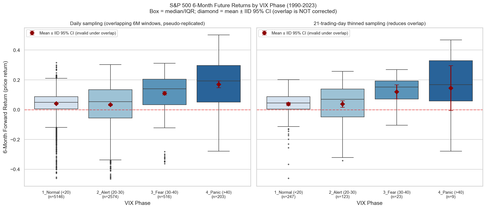
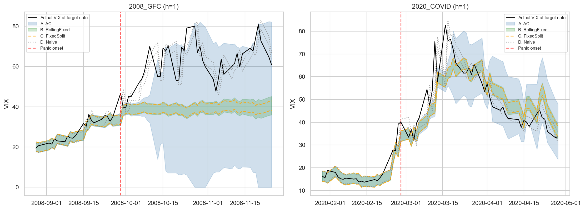
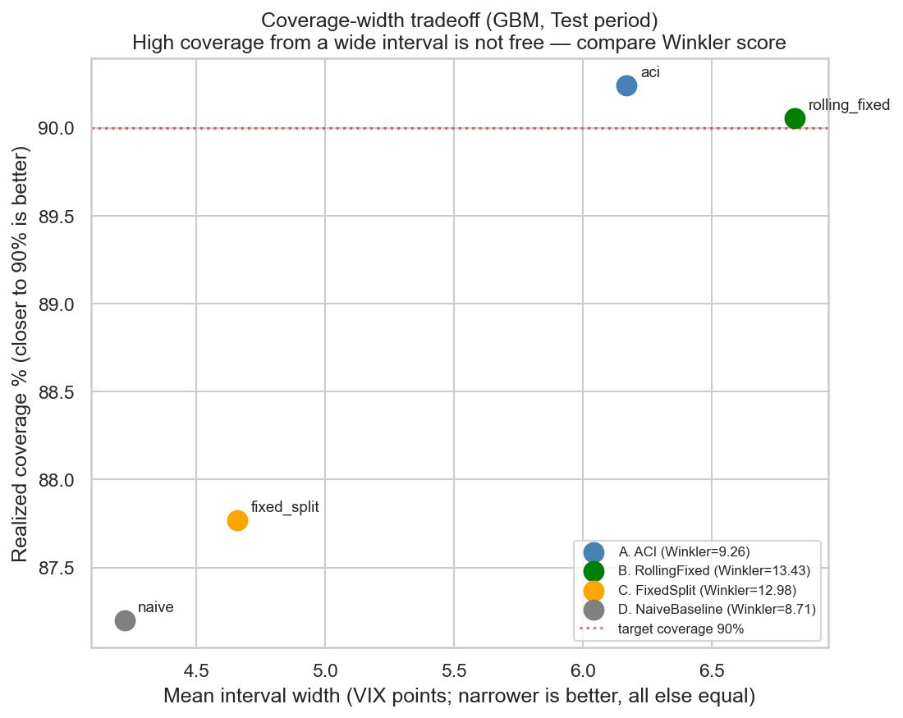

# VIXは何を予測できて、何を予測できないのか

S&P500将来リターンの識別力の検証と、VIX将来値の時系列コンフォーマル予測。

VIX水準と将来リターンの関係を、重複観測・小標本・危機依存の観点から検証する研究です。
後半ではVIX自体のh営業日先水準を予測し、区間幅と実際の被覆率を比較します。

このREADMEの数値・判定は `build_key_results.py` が結果JSONから生成します。
コード変更後は同梱スナップショットで再計算し、README・全数値表・図を同時に更新します。

## 使用データ

S&P500(^GSPC)、VIX(^VIX)、米10年国債利回り(^TNX)の日次終値。
1990-01-02〜2023-12-29、8,565営業日。Yahoo Finance (yfinance 1.5.1)、2026-09-08取得。
生データCSVを同梱し、既定ではネットワーク接続なしで再現します。
S&P500の目的変数は126営業日先の価格リターン（配当を含まない、暦日6ヶ月ではない）。

## 主な結果と解釈

- 日次フェーズANOVAは F=182.6579、p=9.3954e-115。ただし独立観測の前提が成立しません。
- ANOVA残差のDurbin-Watsonは 0.0323。日次の126営業日リターンは大幅に重複します。63日間引きでも重複は残り、そのKruskal-Wallis p=0.0450は探索的参考値です。
- VIX_Zと金利水準の回帰では、HACラグ幅6通りすべてでVIX_Zは5%水準で非有意。水準のフェーズ比較とZスコアの線形回帰は別モデルであり、同じ仮説の再検定ではありません。
- 将来リターン期間が重なるPanicエピソードを統合すると 8個。7個でNormal平均を上回りました。独立性と成功確率0.5を仮定した両側二項検定は p=0.0703。仮定は未検証で、確証的証拠とは扱いません。
- VIX_Z単体OLSの調整済みR²は 0.55%。フェーズANOVAのeta²は 6.10%で、別の量です。全標本内の説明力から売買収益やアウトオブサンプル予測力は判断できません。
- h=1点予測MAE: persistence 1.079 / linear 1.078 / GBM 1.369。固定した設定ではGBMが単純モデルを下回ります。

## h=1予測区間の結果（GBM、N=5421）

| 手法 | カバレッジ（目標90%） | 平均幅 | Winkler score |
|---|---:|---:|---:|
| aci | 90.24% | 6.169 | 9.259 |
| rolling_fixed | 90.06% | 6.821 | 13.427 |
| fixed_split | 87.77% | 4.659 | 12.980 |
| naive | 87.20% | 4.220 | 8.709 |

Winkler scoreは区間幅と外れ幅を同時に評価し、小さい方が良い指標です。
カバレッジ単独の順位を予測区間の優劣として扱いません。

## 手法差の不確実性

2ホライズン × 2モデル × 4比較 × 2指標 = 32比較を1群としてBonferroni補正。
moving block bootstrap 10,000回、ブロック長はh=1で21件、h=21で42件。
各補正区間の信頼水準は99.84375%。時系列依存と非定常性に対する近似で、厳密な保証ではありません。

| h | モデル | Winkler比較 | 平均差 | 補正CI | 判定 |
|---:|---|---|---:|---|---|
| 1 | linear | aci_vs_rolling_fixed | -0.661 | [-1.459, -0.131] | 差を確認（近似） |
| 1 | linear | aci_vs_fixed_split | -0.837 | [-1.989, -0.083] | 差を確認（近似） |
| 1 | linear | aci_vs_naive | -0.996 | [-2.145, -0.241] | 差を確認（近似） |
| 1 | linear | rolling_fixed_vs_fixed_split | -0.175 | [-0.671, +0.292] | 明確な差なし |
| 1 | gbm | aci_vs_rolling_fixed | -4.167 | [-10.821, -0.847] | 差を確認（近似） |
| 1 | gbm | aci_vs_fixed_split | -3.721 | [-11.320, -0.142] | 差を確認（近似） |
| 1 | gbm | aci_vs_naive | +0.550 | [-0.307, +1.784] | 明確な差なし |
| 1 | gbm | rolling_fixed_vs_fixed_split | +0.447 | [-1.335, +2.009] | 明確な差なし |
| 21 | linear | aci_vs_rolling_fixed | +0.687 | [-1.334, +3.270] | 明確な差なし |
| 21 | linear | aci_vs_fixed_split | +1.357 | [-1.270, +4.328] | 明確な差なし |
| 21 | linear | aci_vs_naive | -0.281 | [-3.956, +2.948] | 明確な差なし |
| 21 | linear | rolling_fixed_vs_fixed_split | +0.671 | [-1.569, +2.558] | 明確な差なし |
| 21 | gbm | aci_vs_rolling_fixed | -1.321 | [-6.876, +2.561] | 明確な差なし |
| 21 | gbm | aci_vs_fixed_split | -0.789 | [-7.949, +3.849] | 明確な差なし |
| 21 | gbm | aci_vs_naive | +4.567 | [+0.415, +9.178] | 差を確認（近似） |
| 21 | gbm | rolling_fixed_vs_fixed_split | +0.532 | [-4.198, +4.381] | 明確な差なし |

## 危機前後の記述（h=1、GBM）

Panic突入を63営業日の空白で分ける記述用集計です。これらを独立標本とはみなしません。
予測日基準の各21件の被覆率と、正確な対象日基準の45暦日窓を全数値表に併記します。

| 手法 | 突入前（予測日基準） | 突入後 |
|---|---:|---:|
| aci | 74.8% | 66.0% |
| rolling_fixed | 82.3% | 54.4% |
| fixed_split | 76.9% | 38.8% |
| naive | 77.6% | 43.5% |

## 実装と限界

- 特徴量とターゲットは市場営業日の元インデックスで作成。Treasury欠損除去前の`target_date`を保持し、再学習・残差の解放・較正・危機前後の集計に使用します。
- 当日の終値を観測した後に予測を発行します。当日に確定した過去予測の残差を先に反映。較正末尾の未確定残差も対象日到来時に一度だけ履歴へ追加します。
- FixedSplitとnaiveはceil((n+1)(1-alpha))番目の残差を使います。ローリング手法も同じ順序統計量ですが、順位が標本数を超える場合は最大残差で有限に打ち切ります。
- ACIはalphaを[0.001,0.5]に制限し、直近500件の残差窓を使用。最大残差での打ち切り、更新モデル、時系列の非交換可能性を含むため、90%被覆の理論保証は主張しません。
- 観測効果量による事後検出力は使いません。Semiannual N=67の80% power MDEは Cohen's f=0.4161。独立・等分散ANOVAの計画上の近似で、実データの見逃し率ではありません。
- 間引きの開始位置、VIX閾値、h=1/21、再学習252件、ACI gamma=0.01、ブロック長は固定した探索的設定。感度分析・別市場での一般化・売買バックテストは未実施。
- 図のフェーズ平均CIはIID近似で、重複を補正していない参考表示です。コンフォーマル区間の図は対象日を横軸にして実際のターゲットVIXと比較します。

## 再現方法

Python 3.12、`requirements.txt`の固定バージョンで検証。

```bash
pip install -r requirements.txt
python vix_analysis.py             # 全分析・h=1/21・結果JSON・全図・README・数値表
python conformal_vix_forecast.py   # コンフォーマル部分だけ再計算
python build_key_results.py        # 結果JSONからREADMEと数値表を再生成
python -m pytest tests/ -v
python -m flake8
```

`data_pipeline.py --source online --refresh-snapshot`で元の1990〜2023年データを再取得できます。
対象期間の終端は固定されており、この指定で最新日まで拡張するわけではありません。

## ドキュメントと図

- [全数値表](docs/key_results.md)
- [修正後の手法説明](docs/current_methods.md)
- [以前の詳細レポート（歴史的記録）](docs/detailed_report.md)







## 研究の位置づけとAI利用

VIX水準を説明変数としており、実現分散の予測を差し引く分散リスクプレミアムを構成していません。
Bollerslev, Tauchen & Zhou (2009), Expected Stock Returns and Variance Risk Premiaなどの既存研究に対する新規性や同じ予測力を主張するものではありません。
重複リターンの扱いにはHodrick (1992)などの先行研究があり、本研究ではその比較は未実施です。

初期分析と研究の方向づけは本人が行い、コード監査・再構築・テスト・文書化にClaude Codeを使用しました。
その後、Codexでコードと文書の整合性、日付処理、統計推論を再確認し、修正後の結果を再計算しました。
